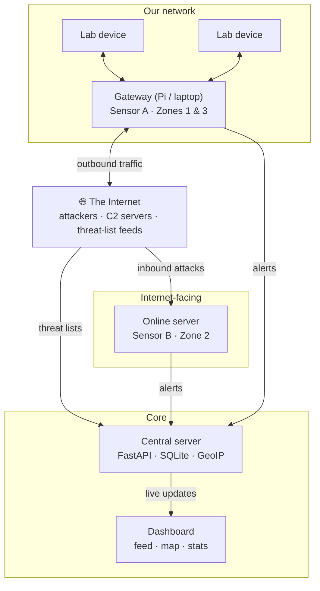

# 🏮 LANTERN

**LAN And Network Threat Explanation & Response Node**

A lightweight, three-zone network intrusion detection system that catches attacks inside your network, coming in from the internet, and leaking out of it, and explains every alert in plain English.


---

## Why LANTERN?

Most security tools that students, colleges and small organisations can actually run watch only **one** part of a network. Real attacks don't stay in one place:

- An intruder on the Wi-Fi can silently intercept everyone's traffic.
- Any server you put online gets scanned and attacked within hours.
- An infected laptop can quietly send data out to an attacker, and nobody notices.

And when tools do raise an alert, it's usually too cryptic for anyone but an expert to act on.

**LANTERN watches all three zones at once and tells you what's happening in words anyone can understand.**

Instead of `ARP anomaly detected`, you get:

> ⚠️ *Laptop 192.168.1.7 is pretending to be your router. Someone may be reading your traffic.*

---

## The three zones

| Zone | What it watches | Example threats |
| --- | --- | --- |
| **1. Inside (LAN)** | Devices on your network attacking each other | ARP spoofing, DNS spoofing, rogue DHCP servers, port scans, plaintext passwords |
| **2. Inbound** | Internet attackers hitting your online server | SSH brute force, SYN floods, SQL injection / XSS attempts |
| **3. Outbound** | Your devices talking to attackers | Malware beaconing, random-looking malware domains (DGA), DNS tunneling, known-bad destinations, data exfiltration |

Most student projects stop at inbound attacks. Zone 3 is where real breaches are usually caught.

---

## Features

### Phase 1: Detection
- 📡 **Real-time packet inspection** with Python and Scapy
- 🧠 **Explainable alerts**: every alert has a severity and a one-line, plain-English reason
- 🌍 **Live dashboard** with an alert feed, per-zone stats and a world map of attacker locations
- 🗂️ **Threat intelligence** from free [abuse.ch](https://abuse.ch/) feeds, refreshed daily
- 🔁 **Replay mode** to run detections on saved capture files, for testing without a live network
- 🛑 **Auto-blocking** of attacker IPs via the Linux firewall *(stretch goal)*

### Phase 2: File scanning & response
- 🔍 **File scanning** of unencrypted downloads using hash lookups (MalwareBazaar), YARA rules and ClamAV
- 💻 **Device agent** that scans new files and **quarantines** suspicious ones (never auto-deletes)
- 🚧 **Device isolation**: the gateway cuts a confirmed-infected device off the network until it's cleared
- 🔗 **Automated response chain**: network detection → trace the responsible program → stop it → quarantine → isolate

---

## Architecture



- **Sensor A** runs on the gateway, so it sees traffic between local devices (Zone 1) and everything leaving for the internet (Zone 3).
- **Sensor B** runs on an internet-facing server and sees what attackers throw at it (Zone 2).
- Both sensors send alerts in **one shared format** to the central server, which powers the dashboard.

---

## Tech stack

| Component | Choice | Why |
| --- | --- | --- |
| Packet capture | Python + Scapy | Dissects every packet field; easy to learn |
| Gateway | Raspberry Pi 4 or Linux laptop | All local traffic passes through it |
| Central server | FastAPI | Lightweight, async, WebSocket support for live alerts |
| Database | SQLite (PostgreSQL later) | Alerts are simple rows; zero setup |
| Threat intel | abuse.ch (Feodo Tracker, URLhaus) | Free, trusted, real malicious infrastructure |
| Geolocation | MaxMind GeoLite2 | Free offline IP-to-country lookup |
| Dashboard | HTML/JS + Chart.js + Leaflet | Simple, no heavy framework |
| Response | iptables, psutil | Blocking, isolation, process tracing |
| File scanning | ClamAV, YARA | Open-source, industry-standard engines |

---

## Repository structure

```
lantern/
├── sensor/          # packet capture, detectors, alert output
│   └── detectors/   # one module per attack type
├── server/          # FastAPI app that receives and stores alerts
├── dashboard/       # live web dashboard
├── agent/           # Phase 2: device file scanner and responder
├── captures/        # saved attack captures for replay testing
├── docs/            # design notes and lab setup
└── tests/
```

---

## Getting started

> ⚠️ LANTERN is under active development. Commands below describe the intended setup and may change.

### Prerequisites
- Linux (Ubuntu, Kali, Raspberry Pi OS) or WSL. Live packet capture needs Linux and root privileges
- Python 3.10+
- Wireshark (recommended, for inspecting captures)

### Install
```bash
git clone https://github.com/<your-org>/lantern.git
cd lantern
python3 -m venv .venv
source .venv/bin/activate
pip install -r requirements.txt
```

### Run
1. **Start the central server** on the machine that will host the dashboard.
2. **Start Sensor A** on the gateway (requires `sudo`), pointing it at the server.
3. **Start Sensor B** on the internet-facing server.
4. **Open the dashboard** in a browser.

To test without a live network, run the sensor in **replay mode** against a file in `captures/`.

---

## Roadmap

- [ ] Sniffer core and shared alert format
- [ ] Zone 1 detections: port scan, ARP spoofing, rogue DHCP
- [ ] Replay mode for saved captures
- [ ] Central server (FastAPI + SQLite)
- [ ] Zone 3 detections: threat feeds, DGA scoring, DNS tunneling, beaconing
- [ ] Zone 2 sensor: SSH brute force, SYN flood, web attack patterns
- [ ] Live dashboard with attacker map
- [ ] Auto-blocking *(stretch)*
- [ ] **Phase 2:** file scanning, device agent, quarantine and isolation

---

## ⚖️ Responsible use

LANTERN is a **defensive** tool built for learning and for protecting networks you own.

- Only monitor networks and devices **you own or have explicit written permission to test**. Capturing traffic on networks you don't control (college Wi-Fi, hostel networks, public Wi-Fi) may be illegal and can lead to disciplinary action.
- All attack testing happens in an **isolated lab** (our own hotspot, laptops and server).
- Demos use **harmless test files** such as [EICAR](https://www.eicar.org/download-anti-malware-testfile/), never real malware.
- Captured test data uses **dummy credentials only**.

The authors are not responsible for misuse of this software.

---

## Acknowledgements

- [Scapy](https://scapy.net/) for packet manipulation
- [abuse.ch](https://abuse.ch/) for free threat intelligence feeds and MalwareBazaar
- This product includes GeoLite2 data created by MaxMind, available from [maxmind.com](https://www.maxmind.com)
- [ClamAV](https://www.clamav.net/) and [YARA](https://virustotal.github.io/yara/) for file scanning
